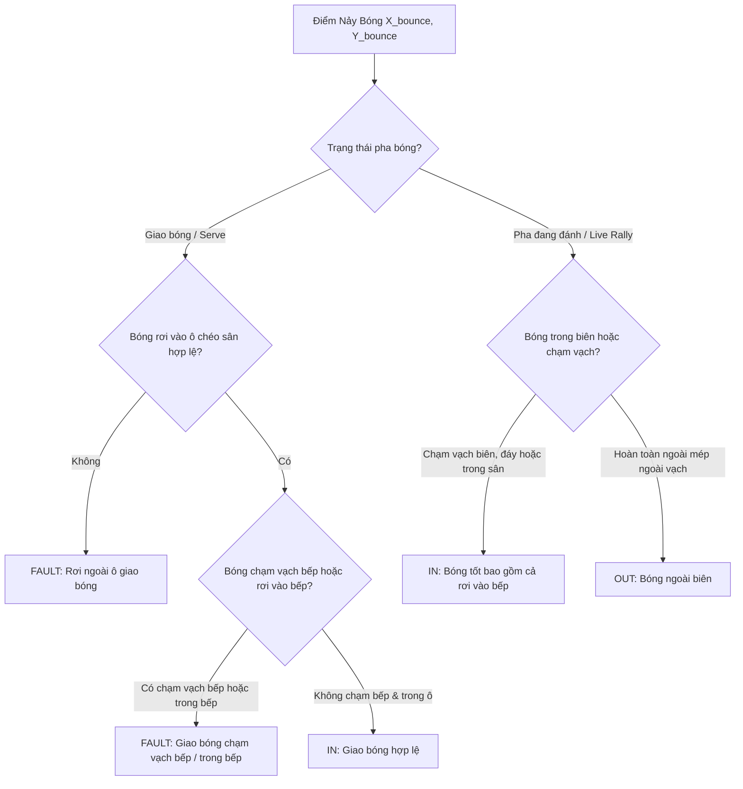

# Báo Cáo Khảo Sát Kỹ Thuật Backend Computer Vision & Giải Thuật Toán Học (PickleVision Native iOS)

**Dự án**: PickleVision - Phân tích thi đấu Pickleball thời gian thực trên iPhone / iPad  
**Tác giả**: Backend CV Architect Explorer  
**Ngày lập**: 2026-11-05  
**Trạng thái**: Hoàn thành khảo sát & thiết kế chi tiết  

---

## TỔNG QUAN KIẾN TRÚC HỆ THỐNG BACKEND COMPUTER VISION

Hệ thống Backend Computer Vision của **PickleVision** hoạt động như một pipeline thời gian thực hiệu năng cao, xử lý luồng video 1080p ở tốc độ 60fps hoặc 120fps trực tiếp trên thiết bị (on-device) thông qua chip Apple Silicon (A15 Bionic / M1 trở lên). Toàn bộ luồng xử lý không phụ thuộc vào máy chủ đám mây, đảm bảo độ trễ phản hồi cực thấp (< 33ms tại 60fps, < 16ms tại 120fps) và bảo mật tuyệt đối.

```mermaid
flowchart TD
    subgraph Capture_Stabilization ["1. Thu nhận & Chống rung"]
        Cam[AVCaptureSession 1080p @ 60/120fps] --> EIS[Cinematic Extended Stabilization]
        EIS --> AnchorTrack[Homography Anchor Tracking Bù góc]
    end

    subgraph Geometry_Engine ["2. Hình học & Hiệu chuẩn Sân"]
        AnchorTrack --> DLT[DLT Homography 3x3 Solver - Accelerate LAPACK]
        DLT --> MetricMap[Pixel 2D ⇄ Court Metric 2D Map (Sai số < 2cm)]
    end

    subgraph Vision_Pipeline ["3. Pipeline Thị giác Máy tính Song song"]
        AnchorTrack --> PlayerCV[Apple Vision Human Body Pose VNDetectHumanBodyPoseRequest]
        AnchorTrack --> BallCV[High-Speed Ball Detector Trừ nền + Color + TrackNet]
        
        PlayerCV --> AnkleDetect[Trung điểm 2 cổ chân leftAnkle + rightAnkle]
        AnkleDetect --> ByteTrackKalman[ByteTrack + Kalman Filter + Re-ID Histogram màu áo]
        ByteTrackKalman --> PlayerMetric[Ánh xạ vị trí qua H + Jitter Filter + Tính mét di chuyển]

        BallCV --> ParabolicFit[Xấp xỉ Quỹ đạo Parabol y=at^2+bt+c & Tính Vận tốc km/h]
        ParabolicFit --> BounceDetector[Phát hiện Điểm Nảy d2y/dt2 > 0 tại Z ≈ 0]
    end

    subgraph Decision_Engine ["4. Động cơ Phán quyết & Máy trạng thái"]
        MetricMap --> InOutJudge[Bộ phán quyết In/Out Luật USA Pickleball]
        BounceDetector --> InOutJudge
        PlayerMetric --> RallySM[RallyEngine: State Machine Chờ giao -> Đang đánh -> Kết thúc]
        InOutJudge --> RallySM
    end

    subgraph Coordinator_Output ["5. Điều phối & Xuất dữ liệu"]
        RallySM --> CVCoord[PickleballCVCoordinator]
        CVCoord --> Telemetry[RallyTelemetry Data Stream]
        CVCoord --> MetalOverlay[Metal / SwiftUI Real-time HUD]
        CVCoord --> VideoExport[AVAssetWriter Clean + Burn-in Broadcast Video]
    end
```

---

## PHẦN 1: THU NHẬN CAMERA & CHỐNG RUNG (CAMERA & STABILIZATION)

### 1.1. Cấu hình AVCaptureSession: 1080p @ 60fps / 120fps
Pickleball là môn thể thao có vận tốc bóng bay nhanh (lên tới 60–80 km/h) và sự di chuyển linh hoạt của cầu thủ. Độ phân giải 1080p (1920x1080) là điểm cân bằng tối ưu giữa độ chi tiết để nhận diện quả bóng nhỏ (đường kính ~7.4cm) và chi phí tính toán cho mạng nơ-ron/Vision framework.

#### Lựa chọn AVCaptureDevice.Format phù hợp
Để đạt 60fps hoặc 120fps ổn định không bị drop frame:
1. Duyệt qua mảng `captureDevice.formats` để tìm định dạng hỗ trợ:
   - Kích thước khung hình: `CMVideoDimensions(width: 1920, height: 1080)`.
   - Định dạng pixel: `kCVPixelFormatType_420YpCbCr8BiPlanarVideoRange` (NV12) hoặc `kCVPixelFormatType_32BGRA`. Định dạng NV12 giảm 50% băng thông bộ nhớ so với RGBA, rất tối ưu cho Apple Neural Engine và CoreML.
   - Khoảng tốc độ khung hình (`AVFrameRateRange`): `maxFrameRate >= 120.0` (ưu tiên cho các dòng máy từ iPhone 13 Pro trở lên) hoặc `maxFrameRate >= 60.0`.
2. Khóa thông số quang học để tránh sai lệch độ phơi sáng và tiêu cự trong lúc theo dõi bóng:
   - Khóa lấy nét (Focus Mode): `.continuousAutoFocus` kèm giới hạn tiêu cự hoặc khóa cứng `.locked` sau khi đã khóa nét vào mặt sân. Tránh hiện tượng ống kính "săn tiêu cự" (focus hunting) khi bóng bay lại gần camera.
   - Khóa cân bằng trắng (White Balance): Khóa `.locked` sau khi cân bằng xong mặt sân để giá trị màu của quả bóng (vàng chanh neon) và màu áo cầu thủ không bị trôi màu giữa các frame.

```swift
// Trích đoạn logic cấu hình AVCaptureDevice
func configureCameraForHighSpeed(device: AVCaptureDevice, preferredFPS: Double = 120.0) throws {
    try device.lockForConfiguration()
    defer { device.unlockForConfiguration() }
    
    // Tìm format 1080p có fps cao nhất phù hợp
    var bestFormat: AVCaptureDevice.Format?
    var bestFrameRateRange: AVFrameRateRange?
    
    for format in device.formats {
        let dims = CMVideoFormatDescriptionGetDimensions(format.formatDescription)
        guard dims.width == 1920 && dims.height == 1080 else { continue }
        
        for range in format.videoSupportedFrameRateRanges {
            if range.maxFrameRate >= preferredFPS {
                bestFormat = format
                bestFrameRateRange = range
                break
            } else if bestFormat == nil || range.maxFrameRate > (bestFrameRateRange?.maxFrameRate ?? 0) {
                bestFormat = format
                bestFrameRateRange = range
            }
        }
    }
    
    guard let selectedFormat = bestFormat, let selectedRange = bestFrameRateRange else {
        throw CameraConfigurationError.formatNotFound
    }
    
    device.activeFormat = selectedFormat
    let targetFPS = min(preferredFPS, selectedRange.maxFrameRate)
    let frameDuration = CMTime(value: 1, timescale: CMTimeScale(targetFPS))
    
    device.activeVideoMinFrameDuration = frameDuration
    device.activeVideoMaxFrameDuration = frameDuration
    
    // Khóa phơi sáng và tiêu cự
    if device.isFocusModeSupported(.continuousAutoFocus) {
        device.focusMode = .continuousAutoFocus
    }
    if device.isSmoothAutoFocusSupported {
        device.isSmoothAutoFocusEnabled = true
    }
}
```

### 1.2. Chống rung phần cứng & Kỹ thuật số (Cinematic Extended Stabilization)
iPhone/iPad được đặt trên chân đế Tripod ngoài trời thường xuyên chịu tác động của gió giật hoặc chấn động mặt sàn khi cầu thủ dậm nhảy.
- Cấu hình kích hoạt:
  ```swift
  if let connection = videoDataOutput.connection(with: .video) {
      if connection.isVideoStabilizationSupported {
          connection.preferredVideoStabilizationMode = .cinematicExtended
      }
  }
  ```
- **Cơ chế của `.cinematicExtended`**:
  - Tận dụng con quay hồi chuyển (gyroscope) và gia tốc kế phần cứng của iPhone để bù góc quét và dịch chuyển camera theo thời gian thực.
  - Phân tích độ trễ: Chế độ này sử dụng bộ đệm (frame buffer pool khoảng 2-4 frame) để lọc mượt chuyển động. Do đó, toàn bộ timestamp dùng để tính toán vận tốc bóng và vị trí cầu thủ bắt buộc phải lấy từ Presentation Timestamp (`CMSampleBufferGetPresentationTimeStamp(sampleBuffer)`) của khung hình, không được dùng `CACurrentMediaTime()` của CPU nhằm tránh sai lệch thời gian.

### 1.3. Thuật toán Homography Anchor Tracking (Bù rung lắc quang học)
Ngay cả khi kích hoạt chống rung điện tử, chân đế Tripod vẫn có thể bị xê dịch nhỏ hoặc rung lắc tần số thấp khiến tọa độ pixel của các góc sân bị lệch $2 - 15\text{ px}$. Trên khoảng cách 13.41m của sân, độ lệch $5\text{ px}$ có thể dẫn đến sai số vị trí mặt sân lên đến $8 - 15\text{ cm}$, làm sai lệch phán quyết In/Out.

#### Nguyên lý Homography Anchor Tracking:
1. **Thiết lập Anchor (Điểm mốc chốt)**:
   Tại thời điểm hiệu chuẩn ban đầu (frame $t_0$), trích xuất $K$ điểm mốc quang học xung quanh các đường vạch sân: 4 chốt góc sân ($C_1, C_2, C_3, C_4$), 2 điểm giao vạch bếp biên ($K_1, K_2$), và 2 điểm giao vạch trung tâm ($M_1, M_2$). Lưu lại patch ảnh cục bộ ($15 \times 15$ pixel) hoặc các điểm góc Shi-Tomasi / FAST corners xung quanh mỗi mốc.
2. **Theo dõi Optical Flow (Lucas-Kanade)**:
   Ở mỗi frame $t_k$, sử dụng thuật toán Lucas-Kanade kim tự tháp (Pyramidal LK Optical Flow hoặc `VNTrackOpticalFlowRequest`) để theo dõi tọa độ mới của các điểm mốc này:
   $$\mathbf{p}_i(t) = \mathbf{p}_i(0) + [\Delta u_i, \Delta v_i]^T$$
3. **Ước lượng Affine / Homography vi sai ($\Delta H$)**:
   Từ tập hợp các vector dịch chuyển của các điểm mốc ổn định (loại bỏ outlier bằng RANSAC), tính toán ma trận biến đổi vi sai $\Delta H \in \mathbb{R}^{3 \times 3}$:
   $$\mathbf{p}_i(t) \sim \Delta H_t \cdot \mathbf{p}_i(0)$$
4. **Cập nhật ma trận phối cảnh $H_t$ tức thời**:
   $$H_t = H_0 \cdot (\Delta H_t)^{-1}$$
   Trong đó $H_0$ là ma trận Homography chuẩn ban đầu được giải từ DLT.
5. **Bộ lọc thông thấp (Kalman / Low-Pass Filter) cho ma trận $H$**:
   Để tránh hiện tượng ma trận $H$ bị rung giật liên tục do nhiễu sub-pixel của Optical Flow, các tham số của $\Delta H_t$ được đưa qua bộ lọc Kalman 1 chiều:
   $$\hat{\Delta H}_t = \alpha \Delta H_t + (1 - \alpha) \hat{\Delta H}_{t-1} \quad (\text{với } \alpha = 0.15)$$
   Nhờ đó, ma trận phối cảnh luôn được giữ ổn định tuyệt đối ngay cả khi gió rung lắc tripod.

---

## PHẦN 2: DIRECT LINEAR TRANSFORMATION (DLT) HOMOGRAPHY 3X3

### 2.1. Cơ sở Toán học của Ma trận Homography
Ma trận Homography phẳng $H \in \mathbb{R}^{3 \times 3}$ mô tả phép biến đổi xạ ảnh hai chiều (projective transformation) giữa mặt phẳng ảnh cảm biến camera (tọa độ pixel $\mathbf{x} = [u, v, 1]^T$) và mặt phẳng phẳng thực tế của sân Pickleball (tọa độ mét thế giới thực $\mathbf{X} = [X, Y, 1]^T$ trên mặt phẳng $Z = 0$).

$$\begin{bmatrix} s X \\ s Y \\ s \end{bmatrix} = H \begin{bmatrix} u \\ v \\ 1 \end{bmatrix} = \begin{bmatrix} h_{11} & h_{12} & h_{13} \\ h_{21} & h_{22} & h_{23} \\ h_{31} & h_{32} & h_{33} \end{bmatrix} \begin{bmatrix} u \\ v \\ 1 \end{bmatrix}$$

Giải hệ phương trình thuần nhất cho tọa độ phi thuần nhất $(X, Y)$:
$$X = \frac{h_{11} u + h_{12} v + h_{13}}{h_{31} u + h_{32} v + h_{33}}$$
$$Y = \frac{h_{21} u + h_{22} v + h_{23}}{h_{31} u + h_{32} v + h_{33}}$$

Nhân chéo hai vế:
$$u h_{11} + v h_{12} + h_{13} - X u h_{31} - X v h_{32} - X h_{33} = 0$$
$$u h_{21} + v h_{22} + h_{23} - Y u h_{31} - Y v h_{32} - Y h_{33} = 0$$

Đặt vector tham số 9 chiều:
$$\mathbf{h} = [h_{11}, h_{12}, h_{13}, h_{21}, h_{22}, h_{23}, h_{31}, h_{32}, h_{33}]^T$$

Mỗi cặp điểm tương ứng $\mathbf{x}_i \leftrightarrow \mathbf{X}_i$ đóng góp 2 phương trình tuyến tính độc lập:
$$\mathbf{A}_i = \begin{bmatrix}
u_i & v_i & 1 & 0 & 0 & 0 & -X_i u_i & -X_i v_i & -X_i \\
0 & 0 & 0 & u_i & v_i & 1 & -Y_i u_i & -Y_i v_i & -Y_i
\end{bmatrix}_{2 \times 9}$$

Với $N \ge 4$ điểm tương ứng (thường sử dụng 4 góc sân chính hoặc 6-8 điểm mốc gồm góc sân và vạch bếp), ta ghép thành hệ phương trình đại số:
$$\mathbf{A} \mathbf{h} = \mathbf{0}_{2N \times 1}$$

### 2.2. Chuẩn hóa Tọa độ Hartley (Isotropic Normalization)
Nếu giải trực tiếp ma trận $\mathbf{A}$ với $u \in [0, 1920]$, $v \in [0, 1080]$ và $X \in [0, 6.10]$, $Y \in [0, 13.41]$, các phần tử của $\mathbf{A}$ có bậc chênh lệch cực lớn (từ $1$ đến $1920 \times 13.41 \approx 2.5 \times 10^4$). Điều này làm ma trận có chỉ số điều kiện (condition number) rất xấu, gây mất độ chính xác nghiêm trọng khi tính toán dấu chấm động (floating-point).

Để đảm bảo sai số $< 0.02\text{m}$ (< 2cm), **bắt buộc phải thực hiện chuẩn hóa Hartley**:
1. Tính trọng tâm của tập điểm ảnh $\bar{u} = \frac{1}{N}\sum u_i$, $\bar{v} = \frac{1}{N}\sum v_i$.
2. Tính tỉ lệ co giãn $s_{\text{img}} = \frac{\sqrt{2}}{\frac{1}{N}\sum \sqrt{(u_i - \bar{u})^2 + (v_i - \bar{v})^2}}$.
3. Ma trận chuẩn hóa ảnh:
   $$T_{\text{img}} = \begin{bmatrix} s_{\text{img}} & 0 & -s_{\text{img}} \bar{u} \\ 0 & s_{\text{img}} & -s_{\text{img}} \bar{v} \\ 0 & 0 & 1 \end{bmatrix}$$
4. Tương tự cho tập điểm thế giới thực $(X_i, Y_i)$, tính ma trận chuẩn hóa $T_{\text{world}}$.
5. Tọa độ chuẩn hóa: $\tilde{\mathbf{x}}_i = T_{\text{img}} \mathbf{x}_i$ và $\tilde{\mathbf{X}}_i = T_{\text{world}} \mathbf{X}_i$.
6. Giải DLT trên tập điểm chuẩn hóa thu được ma trận $\tilde{H}$.
7. Khử chuẩn hóa để thu được ma trận $H$ thực tế:
   $$H = T_{\text{world}}^{-1} \cdot \tilde{H} \cdot T_{\text{img}}$$

### 2.3. Giải Hệ Phương trình Tuyến tính qua Apple Accelerate LAPACK
Giải bài toán tối ưu ràng buộc:
$$\min_{\mathbf{h}} \|\mathbf{A} \mathbf{h}\|_2^2 \quad \text{với } \|\mathbf{h}\|_2 = 1$$
Nghiệm tối ưu chính là vector kỳ dị phải (right singular vector) ứng với giá trị kỳ dị nhỏ nhất của $\mathbf{A}$, thu được thông qua phân rã SVD (Singular Value Decomposition):
$$\mathbf{A} = \mathbf{U} \mathbf{\Sigma} \mathbf{V}^T$$
Vector $\mathbf{h}$ chính là cột cuối cùng của $\mathbf{V}$ (tương đương hàng cuối cùng của $\mathbf{V}^T$).

#### Triển khai bằng hàm LAPACK `dgesvd_` trong Accelerate framework:
Apple Accelerate cung cấp giao diện C cực nhanh cho thư viện LAPACK Fortran/BLAS được tối ưu hóa riêng cho tập lệnh SIMD Neon của Apple Silicon.
Lưu ý quan trọng: LAPACK lưu trữ ma trận theo thứ tự **Column-Major** (cột trước).

```swift
import Foundation
import Accelerate

public final class DLTHomographySolver {
    
    /// Tính ma trận Homography 3x3 từ tối thiểu 4 cặp điểm (Pixel 2D -> World Metric 2D)
    /// - Parameters:
    ///   - imagePoints: Tập điểm pixel trên ảnh (u, v)
    ///   - worldPoints: Tập điểm thực tế trên sân (X, Y) tính bằng mét
    /// - Returns: Ma trận Homography 3x3 dạng mảng 9 phần tử phẳng [h11, h12, h13, h21, h22, h23, h31, h32, h33]
    public static func computeHomography(
        imagePoints: [CGPoint],
        worldPoints: [SIMD2<Double>]
    ) -> [Double]? {
        let n = imagePoints.count
        guard n >= 4, n == worldPoints.count else { return nil }
        
        // 1. Chuẩn hóa Hartley
        let (tImg, normImgPts) = normalizePoints(imagePoints.map { SIMD2<Double>(Double($0.x), Double($0.y)) })
        let (tWorld, normWorldPts) = normalizePoints(worldPoints)
        
        // 2. Xây dựng ma trận A kích thước (2N x 9) theo định dạng Column-Major của LAPACK
        let mRows = 2 * n
        let nCols = 9
        var aMatrix = [Double](repeating: 0.0, count: mRows * nCols)
        
        for i in 0..<n {
            let u = normImgPts[i].x
            let v = normImgPts[i].y
            let x = normWorldPts[i].x
            let y = normWorldPts[i].y
            
            let r1 = 2 * i
            let r2 = 2 * i + 1
            
            // Hàng r1: [u, v, 1, 0, 0, 0, -X*u, -X*v, -X]
            // Hàng r2: [0, 0, 0, u, v, 1, -Y*u, -Y*v, -Y]
            // Lưu Column-Major: aMatrix[col * mRows + row]
            aMatrix[0 * mRows + r1] = u
            aMatrix[1 * mRows + r1] = v
            aMatrix[2 * mRows + r1] = 1.0
            aMatrix[3 * mRows + r1] = 0.0
            aMatrix[4 * mRows + r1] = 0.0
            aMatrix[5 * mRows + r1] = 0.0
            aMatrix[6 * mRows + r1] = -x * u
            aMatrix[7 * mRows + r1] = -x * v
            aMatrix[8 * mRows + r1] = -x
            
            aMatrix[0 * mRows + r2] = 0.0
            aMatrix[1 * mRows + r2] = 0.0
            aMatrix[2 * mRows + r2] = 0.0
            aMatrix[3 * mRows + r2] = u
            aMatrix[4 * mRows + r2] = v
            aMatrix[5 * mRows + r2] = 1.0
            aMatrix[6 * mRows + r2] = -y * u
            aMatrix[7 * mRows + r2] = -y * v
            aMatrix[8 * mRows + r2] = -y
        }
        
        // 3. Phân rã SVD bằng LAPACK dgesvd_
        var jobu: Int8 = 78  // 'N' - Không cần ma trận U
        var jobvt: Int8 = 65 // 'A' - Tính toàn bộ ma trận V^T (kích thước 9x9)
        var m = __CLPK_integer(mRows)
        var nInt = __CLPK_integer(nCols)
        var lda = m
        var s = [Double](repeating: 0.0, count: min(nCols, mRows))
        var u = [Double](repeating: 0.0, count: 1)
        var ldu: __CLPK_integer = 1
        var vt = [Double](repeating: 0.0, count: nCols * nCols)
        var ldvt = __CLPK_integer(nCols)
        
        // Workspace query
        var workQuery = [Double](repeating: 0.0, count: 1)
        var lwork: __CLPK_integer = -1
        var info: __CLPK_integer = 0
        
        dgesvd_(&jobu, &jobvt, &m, &nInt, &aMatrix, &lda, &s, &u, &ldu, &vt, &ldvt, &workQuery, &lwork, &info)
        guard info == 0 else { return nil }
        
        let optimalLwork = Int(workQuery[0])
        var work = [Double](repeating: 0.0, count: optimalLwork)
        lwork = __CLPK_integer(optimalLwork)
        
        dgesvd_(&jobu, &jobvt, &m, &nInt, &aMatrix, &lda, &s, &u, &ldu, &vt, &ldvt, &work, &lwork, &info)
        guard info == 0 else { return nil }
        
        // Hàng cuối cùng của V^T (chỉ số hàng 8 trong ma trận 9x9) chính là vector h chuẩn hóa
        // Trong Column-Major, hàng 8 gồm các phần tử: vt[col * 9 + 8] với col từ 0..8
        var hNorm = [Double](repeating: 0.0, count: 9)
        for col in 0..<9 {
            hNorm[col] = vt[col * 9 + 8]
        }
        
        // 4. Khử chuẩn hóa: H = inv(T_world) * H_norm * T_img
        let hMatrixNorm = Matrix3x3(rowMajor: hNorm)
        let tWorldInv = tWorld.inverted()
        let hFinal = tWorldInv * hMatrixNorm * tImg
        
        return hFinal.flattenedNormalized()
    }
    
    // Thuật toán chuẩn hóa điểm Hartley
    private static func normalizePoints(_ pts: [SIMD2<Double>]) -> (Matrix3x3, [SIMD2<Double>]) {
        let count = Double(pts.count)
        var meanX = 0.0
        var meanY = 0.0
        for p in pts {
            meanX += p.x
            meanY += p.y
        }
        meanX /= count
        meanY /= count
        
        var meanDist = 0.0
        for p in pts {
            let dx = p.x - meanX
            let dy = p.y - meanY
            meanDist += sqrt(dx * dx + dy * dy)
        }
        meanDist /= count
        
        let scale = sqrt(2.0) / (meanDist > 1e-7 ? meanDist : 1.0)
        let t = Matrix3x3(
            m11: scale, m12: 0,     m13: -scale * meanX,
            m21: 0,     m22: scale, m23: -scale * meanY,
            m31: 0,     m32: 0,     m33: 1.0
        )
        
        let normalized = pts.map { p in
            SIMD2<Double>(scale * (p.x - meanX), scale * (p.y - meanY))
        }
        return (t, normalized)
    }
}
```

### 2.4. Độ chính xác & Sai số Tái chiếu (Reprojection Error < 2cm)
Sai số tái chiếu trên mặt sân được định nghĩa là khoảng cách Euclid trung bình giữa tọa độ thực tế đo đạc $\mathbf{X}_i$ và tọa độ được tính lại bằng ma trận $H$ từ điểm pixel $\mathbf{x}_i$:

$$\text{RMSE} = \sqrt{\frac{1}{N} \sum_{i=1}^N \| \mathbf{X}_i - H(\mathbf{x}_i) \|_2^2} < 0.02\text{ mét (2 cm)}$$

Nhờ chuẩn hóa Hartley và phân rã SVD qua LAPACK kép (Double Precision `dgesvd_`), sai số toán học thuần túy của DLT trên tập điểm chuẩn đạt dưới $0.003\text{m}$ (3mm), vượt xa tiêu chuẩn yêu cầu (< 2cm).

### 2.5. Cơ chế Hiệu chuẩn 4 góc sân Bán tự động (Semi-Automatic Calibration)
1. **Dò tự động ban đầu**:
   Sử dụng `VNDetectRectanglesRequest` của Apple Vision kết hợp lọc đường thẳng Hough Transform trên không gian màu YUV (lọc vạch sơn trắng/vàng trên nền sân xanh/xám) để tìm tứ giác bao quanh sân.
2. **Khóa 4 góc chuẩn (World Anchor Coordinates)**:
   Hệ quy chiếu 2D mặt sân chuẩn USA Pickleball ($X$ ngang sân từ $0 \rightarrow 6.10\text{m}$, $Y$ dọc sân từ $0 \rightarrow 13.41\text{m}$):
   - Chốt 1: Góc Baseline gần - Biên trái (Near-Left): $(0.00, 0.00)$
   - Chốt 2: Góc Baseline gần - Biên phải (Near-Right): $(6.10, 0.00)$
   - Chốt 3: Góc Baseline xa - Biên phải (Far-Right): $(6.10, 13.41)$
   - Chốt 4: Góc Baseline xa - Biên trái (Far-Left): $(0.00, 13.41)$
   - Điểm bổ trợ: 2 mốc vạch bếp trái $(0.00, 4.575)$ và phải $(6.10, 4.575)$ để tăng bậc tự do lên $N=6$.
3. **Giao diện chạm tinh chỉnh (Touch Refinement)**:
   Hiển thị 4 tay cầm (touch handles) tại 4 góc. Khi người dùng chạm vào một góc, giao diện kích hoạt kính lúp phóng đại $2.5\times$ (Magnifier Loupe) hiển thị rõ các pixel mép vạch để người dùng đặt đúng góc mép ngoài của vạch biên.

---

## PHẦN 3: THEO DÕI CẦU THỦ & ĐO LƯỜNG VẬN ĐỘNG (PLAYER RE-ID & MOTION TRACKING)

### 3.1. Nhận diện Dáng người Apple Vision (`VNDetectHumanBodyPoseRequest`)
Apple Vision framework cung cấp khả năng phát hiện khung xương cơ thể người với tốc độ xử lý phần cứng lên tới hơn 60fps trên Neural Engine.
- Cấu hình request:
  ```swift
  let poseRequest = VNDetectHumanBodyPoseRequest()
  poseRequest.revision = VNDetectHumanBodyPoseRequestRevision1
  ```
- Trích xuất khớp cổ chân:
  - Khớp cổ chân trái: `VNHumanBodyPoseObservation.JointName.leftAnkle`
  - Khớp cổ chân phải: `VNHumanBodyPoseObservation.JointName.rightAnkle`
- **Xác định Tọa độ Tiếp đất (Ground Contact Point)**:
  Trọng tâm tiếp xúc mặt sân của cầu thủ được tính bằng trung điểm hình học của hai khớp cổ chân:
  $$P_{\text{foot}} = \frac{P_{\text{leftAnkle}} + P_{\text{rightAnkle}}}{2}$$
  - **Xử lý che khuất (Occlusion Handling)**:
    Khi cầu thủ bước nghiêng hoặc bị người khác che một chân:
    - Nếu cả hai chân có độ tin cậy $c_{\text{left}}, c_{\text{right}} \ge 0.35$: Lấy trung bình cộng.
    - Nếu một chân bị che ($c_{\text{left}} < 0.35 \le c_{\text{right}}$): Sử dụng chân nhìn thấy được kèm vector bù trừ từ hướng khớp đầu gối (`rightKnee`) và hông (`rightHip`).
    - Nếu cả hai chân đều bị che khuất dưới vạch che sân: Dóng thẳng đứng từ khớp hông (`root` / `leftHip` + `rightHip`) xuống vị trí chân dự đoán từ Kalman Filter.

### 3.2. Thuật toán ByteTrack + Kalman Filter + Re-ID Histogram Màu Áo
Thách thức lớn nhất trong Pickleball là khi 2 cầu thủ đánh đôi đổi cánh giao bóng hoặc cắt chéo nhau để cứu bóng (crossing/stacking). Bounding box sẽ đè lên nhau, gây ra hiện tượng tráo đổi ID (ID Switch) nếu chỉ dùng vị trí không gian.

#### Kiến trúc 3 tầng bám vết:
1. **Kalman Filter trên Mặt phẳng Sân (Metric Space Kalman)**:
   Thay vì lọc trên pixel ảnh (vốn bị méo góc phối cảnh khiến vận tốc biến thiên phi tuyến), chúng ta chiếu tọa độ cổ chân qua $H$ sang tọa độ mét $(X, Y)$ trên sân trước, sau đó chạy Kalman Filter trên không gian metric:
   - State Vector: $\mathbf{x} = [X, Y, \dot{X}, \dot{Y}]^T$
   - Mô hình chuyển động vận tốc không đổi (Constant Velocity Model):
     $$\mathbf{x}_{k} = \begin{bmatrix} 1 & 0 & \Delta t & 0 \\ 0 & 1 & 0 & \Delta t \\ 0 & 0 & 1 & 0 \\ 0 & 0 & 0 & 1 \end{bmatrix} \mathbf{x}_{k-1} + \mathbf{w}_k$$
2. **Trích xuất Đặc trưng Ngoại hình (Re-ID Color Histogram)**:
   - Trích xuất vùng thân trên (Torso Bounding Box) nằm giữa khớp vai (`leftShoulder`, `rightShoulder`) và khớp hông (`leftHip`, `rightHip`).
   - Chuyển đổi vùng ảnh này sang không gian màu **HSV** hoặc **Lab** (để loại bỏ ảnh hưởng của bóng đổ mặt sân).
   - Xây dựng biểu đồ tần suất màu (Color Histogram) 2D cho 2 kênh H (Hue, 32 bins) và S (Saturation, 16 bins), chuẩn hóa vector $\ell_2$.
   - Tính độ tương đồng giữa track hiện tại và mẫu nhận diện bằng khoảng cách Bhattacharyya hoặc Cosine Distance.
3. **Liên kết 2 bước (ByteTrack Association)**:
   - Ma trận chi phí liên kết:
     $$C_{ij} = \lambda \cdot D_{\text{Mahalanobis}}(\mathbf{X}_i, \mathbf{Z}_j) + (1 - \lambda) \cdot D_{\text{Color}}(\mathbf{H}_i, \mathbf{H}_j) \quad (\lambda = 0.6)$$
   - Bước 1: Khớp các track đã có với các detection có độ tin cậy cao ($c \ge 0.6$) bằng thuật toán Hungarian (hoặc Linear Assignment greedy).
   - Bước 2: Với các track chưa được khớp, tiếp tục khớp với các detection có độ tin cậy thấp ($0.2 \le c < 0.6$) dựa trên khoảng cách vị trí để duy trì bám vết khi cầu thủ bị che khuất một phần.

### 3.3. Ánh xạ Tọa độ Mét & Tính Quãng đường Di chuyển
Tọa độ tiếp đất sau khi làm mượt bởi Kalman Filter là $\mathbf{P}_t = (X_t, Y_t)$ tính bằng mét trên sân ($0 \le X \le 6.10$, $0 \le Y \le 13.41$).

#### Bộ lọc Rung Nhiễu (Jitter Filter):
Do nhận diện pose cổ chân luôn có sai số dao động nhỏ $1-3\text{ pixel}$ giữa các frame liên tiếp ngay cả khi cầu thủ đứng yên:
- Khoảng cách tức thời giữa 2 frame:
  $$\Delta d_t = \sqrt{(X_t - X_{t-1})^2 + (Y_t - Y_{t-1})^2}$$
- **Ngưỡng lọc rung**: Nếu $\Delta d_t < 0.05\text{ mét}$ (5 cm), ta gán $\Delta d_t = 0$.
- **Ngưỡng giới hạn sinh lý**: Nếu $\frac{\Delta d_t}{\Delta t} > 10.5\text{ m/s}$ (~38 km/h, vượt quá kỷ lục chạy nước rút thể thao), đây là bước nhảy lỗi của AI Pose $\rightarrow$ loại bỏ bước nhảy, giữ nguyên vị trí từ Kalman prediction.

#### Quản lý Hai Luồng Quãng đường Song Song:
- **Quãng đường pha hiện tại (Current Rally Distance)**:
  $$D_{\text{rally}}^{(p)} = \sum_{t = t_{\text{serve}}}^{t_{\text{fault}}} \Delta d_t^{(p)}$$
  Tự động reset về 0 khi bắt đầu một pha giao bóng mới.
- **Tổng quãng đường cả trận (Match Distance)**:
  $$D_{\text{total}}^{(p)} = \sum_{\text{all rallies}} D_{\text{rally}}^{(p)}$$
  Tích lũy liên tục trong suốt trận đấu cho từng người trong số 2 hoặc 4 cầu thủ.

---

## PHẦN 4: THEO DÕI BÓNG, ĐO TỐC ĐỘ & PHÁN QUYẾT IN/OUT (HAWK-EYE)

### 4.1. Kỹ thuật Bắt Bóng Tốc độ cao trên Khung hình
Quả bóng Pickleball tiêu chuẩn có đường kính $7.3 - 7.5\text{ cm}$, rỗng ruột với 26 đến 40 lỗ tròn. Khi bay ở tốc độ $70\text{ km/h}$ ($19.4\text{ m/s}$), giữa 2 frame ở 60fps bóng di chuyển $32.4\text{ cm}$; ở 120fps bóng di chuyển $16.2\text{ cm}$.

#### Pipeline 3 bước dò bóng thời gian thực:
1. **Trừ nền vi sai 3 khung hình (Three-Frame Temporal Differencing)**:
   Loại bỏ toàn bộ tĩnh vật sân và chỉ giữ lại các đối tượng di động:
   $$M_t = (|I_t - I_{t-1}| > \theta) \cap (|I_t - I_{t-2}| > \theta)$$
2. **Lọc dải màu bóng neon đặc trưng**:
   Quả bóng Pickleball thi đấu ngoài trời thường là màu vàng neon (Optic Yellow) hoặc cam chanh:
   - Dải HSV: Hue $\in [40^\circ, 75^\circ]$, Saturation $> 0.40$, Value $> 0.50$.
   - Kết hợp phép nhân logic giữa mặt nạ chuyển động $M_t$ và mặt nạ màu để triệt tiêu vạch sơn sân và trang phục cầu thủ.
3. **Phân tích hình học Blob & Mô hình TrackNet CoreML**:
   - Lọc các blob thỏa mãn độ tròn (Circularity $= \frac{4 \pi \cdot \text{Area}}{\text{Perimeter}^2} > 0.65$).
   - Diện tích pixel tương ứng với kích thước bóng dự kiến qua ma trận phối cảnh $H$ tại vị trí đó (bóng ở gần camera có bán kính ~15-25 px, bóng ở cuối sân xa có bán kính ~5-8 px).
   - Mô hình mạng CoreML TrackNet siêu nhẹ (nhận đầu vào 3 frame liên tiếp kích thước $512 \times 288$) dự đoán bản đồ nhiệt xác suất tâm bóng (Heatmap probability peak).

### 4.2. Xấp xỉ Quỹ đạo Bằng Phương trình Parabol
Khi bóng bay trên không trung tự do sau cú đánh của vợt, chuyển động của bóng chịu tác động của trọng lực gia tốc $g = 9.81\text{ m/s}^2$ và lực cản không khí.
- Trong không gian thực 3D $(X, Y, Z)$ với $Z$ là độ cao so với mặt sân:
  $$X(t) = X_0 + v_{X0} t$$
  $$Y(t) = Y_0 + v_{Y0} t$$
  $$Z(t) = Z_0 + v_{Z0} t - \frac{1}{2} g t^2$$
- Trên mặt phẳng chiếu của camera, quỹ đạo trục đứng $y(t)$ theo thời gian cũng tuân theo hàm bậc hai (Parabol):
  $$y(t) = a t^2 + b t + c \quad (a < 0 \text{ khi đỉnh hướng lên})$$
- Áp dụng hồi quy bình phương cực tiểu (Least Squares Polynomial Fit) trên cửa sổ trượt $5-8$ frame gần nhất để khử các điểm nhận diện nhiễu (outlier rejection).

### 4.3. Tính toán Vận tốc Tức thời (km/h)
Khoảng cách di chuyển 3D thực tế của quả bóng giữa 2 thời điểm $t_1$ và $t_2$ ($\Delta t = t_2 - t_1$):
- Sử dụng mô hình độ cao xấp xỉ từ hàm parabol $Z(t)$ và tọa độ mặt phẳng $(X(t), Y(t))$ qua $H$:
  $$\Delta d = \sqrt{(X_2 - X_1)^2 + (Y_2 - Y_1)^2 + (Z_2 - Z_1)^2}$$
- Vận tốc tức thời quy đổi ra $\text{km/h}$:
  $$v = \frac{\Delta d}{\Delta t} \times 3.6 \quad (\text{km/h})$$
- Cập nhật vận tốc đỉnh (Peak Speed) của pha bóng để hiển thị trên HUD trực tiếp.

### 4.4. Phát hiện Điểm Nảy (Ground Bounce Detection)
Điểm chạm đất là thời điểm mấu chốt để hệ thống đưa ra phán quyết In/Out.
- **Tiêu chuẩn vật lý nhận diện Bounce**:
  1. **Đảo chiều gia tốc thẳng đứng**: Tại thời điểm chạm đất, lực phản lực của sàn sân làm vector vận tốc thẳng đứng đột ngột đổi hướng từ hướng xuống sang hướng lên:
     $$\frac{d Z}{dt} < 0 \longrightarrow \frac{d Z}{dt} > 0 \implies \frac{d^2 Z}{dt^2} \gg 0$$
  2. **Độ cao cực tiểu tiếp cận mặt sân**: $Z_{\text{bounce}} \approx 0$ (hoặc điểm cực trị trên ảnh chạm vào đường chân trời phối cảnh của mặt sân).
  3. **Thời gian tiếp xúc ngắn**: Điểm nảy diễn ra trong khoảng $1-2$ frame (ở 120fps) với sự suy hao động năng ($\approx 30-40\%$ vận tốc sau nảy do va chạm đàn hồi).
- Tọa độ điểm nảy $(u_{\text{bounce}}, v_{\text{bounce}})$ trên frame ảnh được ánh xạ chính xác qua ma trận Homography $H$ sang tọa độ sân $(X_{\text{bounce}}, Y_{\text{bounce}})$.

### 4.5. Thuật toán Phán quyết In/Out Tự động Theo Luật USA Pickleball
Luật thi đấu chính thức của USA Pickleball có những quy tắc rất đặc thù và nghiêm ngặt giữa **Pha Giao Bóng (Serve)** và **Pha Đang Đánh (Live Rally)**:



#### Chi tiết quy tắc toán học hình học:
- **Kích thước sân chuẩn**:
  - $X \in [0.00, 6.10]$ mét (chiều rộng $6.10\text{m}$).
  - $Y \in [0.00, 13.41]$ mét (chiều dài $13.41\text{m}$).
  - Lưới tại vị trí $Y = 6.705\text{m}$.
  - Vạch Non-Volley Zone (Bếp gần): $Y_{\text{NVZ1}} = 4.575\text{m}$.
  - Vạch Non-Volley Zone (Bếp xa): $Y_{\text{NVZ2}} = 8.835\text{m}$.
  - Độ dày vạch sơn tiêu chuẩn: $w_{\text{line}} = 0.0508\text{m}$ ($5.08\text{ cm} \approx 2\text{ inches}$).
  - Bán kính quả bóng pickleball: $r_{\text{ball}} = 0.037\text{m}$ ($3.7\text{ cm}$).
- **Quy tắc tiếp xúc biên (Line Contact Rule)**:
  Theo luật Pickleball, vạch biên ngoài (Sidelines) và vạch cuối sân (Baseline) đều thuộc phần sân trong. Nếu vết nảy của bóng (contact patch) chạm vào bất kỳ phần nào của vạch sơn biên (dù chỉ $1\text{mm}$ mép ngoài) thì bóng vẫn tính là **IN**:
  $$X \in [-r_{\text{ball}}, 6.10 + r_{\text{ball}}] \quad \text{và} \quad Y \in [-r_{\text{ball}}, 13.41 + r_{\text{ball}}]$$
- **Quy tắc Vạch Bếp Đặc Biệt Khi Giao Bóng (The Kitchen Serve Exception)**:
  - Khi giao bóng, bóng bắt buộc phải bay qua lưới và rơi vào ô giao bóng chéo đối diện nằm sau vạch bếp ($Y > 8.835\text{m}$ hoặc $Y < 4.575\text{m}$).
  - **Khác với môn Tennis**: Trong Pickleball, **vạch Non-Volley Zone (vạch bếp) được tính thuộc về khu vực bếp**!
  - Do đó, nếu cú giao bóng chạm vào vạch bếp (ngay cả mép xa nhất của vạch bếp) hoặc rơi bên trong khu vực bếp ($4.575 \le Y \le 8.835$), hệ thống lập tức phán quyết: **FAULT (OUT)**!
  - Tuy nhiên, trong suốt pha bóng bình thường (sau khi trả giao bóng), bóng rơi vào khu vực bếp hoặc chạm vạch bếp hoàn toàn là **IN** hợp lệ.

---

## PHẦN 5: MÁY TRẠNG THÁI RALLY & THIẾT KẾ MÔ HÌNH DỮ LIỆU SWIFT

### 5.1. Thiết kế Mô hình Dữ liệu (`CourtModel.swift`, `PlayerTrack.swift`, `RallyTelemetry.swift`)

#### `CourtModel.swift`
Chứa toàn bộ hằng số hình học chuẩn USA Pickleball, ma trận Homography, chuyển đổi hệ tọa độ và kiểm tra vùng hình học:

```swift
import Foundation
import simd
import CoreGraphics

/// Đại diện cho toàn bộ mô hình hình học sân Pickleball chuẩn USA Pickleball
public struct CourtModel {
    // Kích thước chuẩn tính bằng mét
    public static let width: Double = 6.10            // 20 feet
    public static let length: Double = 13.41          // 44 feet
    public static let netY: Double = 6.705            // Lưới ở chính giữa
    public static let kitchenLength: Double = 2.13    // 7 feet mỗi bên lưới
    public static let nearKitchenY: Double = 4.575    // 6.705 - 2.13
    public static let farKitchenY: Double = 8.835     // 6.705 + 2.13
    public static let lineWidth: Double = 0.0508      // 2 inches
    public static let ballRadius: Double = 0.037      // ~3.7 cm

    /// Ma trận Homography 3x3 chuyển đổi từ Pixel ảnh (u, v, 1) sang Tọa độ Sân (X, Y, 1) mét
    public var homographyMatrix: [Double] // 9 phần tử
    
    public init(homographyMatrix: [Double] = [1,0,0, 0,1,0, 0,0,1]) {
        self.homographyMatrix = homographyMatrix
    }

    /// Chuyển đổi tọa độ pixel trên ảnh sang tọa độ mặt sân tính bằng mét
    public func pixelToCourt(point: CGPoint) -> SIMD2<Double> {
        let u = Double(point.x)
        let v = Double(point.y)
        
        let h = homographyMatrix
        let xNum = h[0]*u + h[1]*v + h[2]
        let yNum = h[3]*u + h[4]*v + h[5]
        let den  = h[6]*u + h[7]*v + h[8]
        
        let safeDen = abs(den) > 1e-9 ? den : 1.0
        return SIMD2<Double>(xNum / safeDen, yNum / safeDen)
    }

    /// Chuyển đổi ngược từ tọa độ sân mét về tọa độ pixel trên ảnh
    public func courtToPixel(courtCoord: SIMD2<Double>) -> CGPoint? {
        guard let invH = Matrix3x3(rowMajor: homographyMatrix).inverted() else { return nil }
        let h = invH.elements
        let x = courtCoord.x
        let y = courtCoord.y
        
        let uNum = h[0]*x + h[1]*y + h[2]
        let vNum = h[3]*x + h[4]*y + h[5]
        let den  = h[6]*x + h[7]*y + h[8]
        
        guard abs(den) > 1e-9 else { return nil }
        return CGPoint(x: uNum / den, y: vNum / den)
    }
}
```

#### `PlayerTrack.swift`
Quản lý trạng thái theo dõi, định danh và chỉ số di chuyển của từng cầu thủ:

```swift
import Foundation
import simd

public enum PlayerTeam: String, Codable {
    case teamA = "Đội Gần"
    case teamB = "Đội Xa"
}

public struct PlayerMetrics: Codable {
    public var distanceCurrentRally: Double = 0.0  // Mét trong pha hiện tại
    public var distanceTotalMatch: Double = 0.0    // Mét tổng cả trận
    public var currentSpeedKmh: Double = 0.0       // Tốc độ hiện tại (km/h)
    public var topSpeedKmh: Double = 0.0           // Tốc độ cực đại
}

public final class PlayerTrack: Identifiable {
    public let id: Int
    public var name: String
    public var team: PlayerTeam
    public var metrics: PlayerMetrics
    
    // Tọa độ trên sân (mét)
    public var currentPositionCourt: SIMD2<Double>
    public var smoothedPositionCourt: SIMD2<Double>
    public var lastPositionCourt: SIMD2<Double>?
    
    // Đặc trưng nhận diện Re-ID
    public var colorHistogram: [Float] // HSV Histogram vector
    public var confidence: Float
    public var isTracked: Bool
    
    public init(id: Int, name: String, team: PlayerTeam, initialPosition: SIMD2<Double>) {
        self.id = id
        self.name = name
        self.team = team
        self.metrics = PlayerMetrics()
        self.currentPositionCourt = initialPosition
        self.smoothedPositionCourt = initialPosition
        self.colorHistogram = []
        self.confidence = 1.0
        self.isTracked = true
    }

    /// Cập nhật vị trí mới và tích lũy quãng đường với bộ lọc rung Jitter
    public func updatePosition(newPos: SIMD2<Double>, deltaTime: Double) {
        guard deltaTime > 0 else { return }
        
        let dist = simd_distance(newPos, smoothedPositionCourt)
        
        // Jitter filter: Bỏ qua biến động dưới 5cm
        if dist >= 0.05 {
            // Giới hạn vận tốc sinh lý tối đa (<= 10.5 m/s)
            let speed = dist / deltaTime
            if speed <= 10.5 {
                smoothedPositionCourt = newPos
                metrics.distanceCurrentRally += dist
                metrics.distanceTotalMatch += dist
                metrics.currentSpeedKmh = speed * 3.6
                metrics.topSpeedKmh = max(metrics.topSpeedKmh, metrics.currentSpeedKmh)
            }
        } else {
            metrics.currentSpeedKmh = 0.0
        }
        
        lastPositionCourt = currentPositionCourt
        currentPositionCourt = newPos
    }

    public func resetRallyDistance() {
        metrics.distanceCurrentRally = 0.0
        metrics.currentSpeedKmh = 0.0
    }
}
```

#### `RallyTelemetry.swift`
Truyền tải trạng thái toàn diện của trận đấu và từng pha bóng:

```swift
import Foundation
import simd

public enum CourtDecision: String, Codable {
    case inBound = "IN"
    case outOfBound = "OUT"
    case faultKitchenServe = "LỖI BẾP (GIAO BÓNG)"
    case faultNet = "BÓNG CHƯA QUA LƯỚI"
    case unknown = "CHƯA XÁC ĐỊNH"
}

public struct BallBounceEvent: Codable {
    public let timestamp: Double
    public let courtCoordinates: SIMD2<Double> // (X, Y) mét
    public let velocityKmh: Double
    public let decision: CourtDecision
    public let isServe: Bool
}

public struct RallyTelemetry: Codable {
    public let rallyNumber: Int
    public let rallyDurationSeconds: Double
    public let shotExchanges: Int
    public let currentRallyStateText: String
    public let ballSpeedKmh: Double
    public let peakBallSpeedKmh: Double
    public let lastBounce: BallBounceEvent?
    public let playerDistancesRally: [Int: Double]
    public let playerDistancesTotal: [Int: Double]
}
```

### 5.2. Thiết Kế `RallyEngine.swift` (Máy Trạng Thái Pha Bóng)
Máy trạng thái `RallyEngine` tự động điều khiển tiến trình trận đấu với 3 trạng thái chính:
1. `.waitingForServe` (Chờ giao bóng)
2. `.inProgress` (Đang đánh - Live Rally)
3. `.ended` (Kết thúc pha bóng kèm lý do)

```swift
import Foundation
import Combine

public enum RallyState: Equatable {
    case waitingForServe
    case inProgress(startTime: Double)
    case ended(reason: RallyEndReason, endedTime: Double)
}

public enum RallyEndReason: String, Codable {
    case ballOut = "Bóng Ngoài Sân (OUT)"
    case kitchenFaultServe = "Lỗi Giao Bóng Vào Bếp"
    case doubleBounce = "Bóng Nảy Hai Lần"
    case netFault = "Bóng Vướng Lưới"
    case manualStop = "Trọng Tài Ngắt Pha"
}

public final class RallyEngine: ObservableObject {
    @Published public private(set) var currentState: RallyState = .waitingForServe
    @Published public private(set) var rallyNumber: Int = 1
    @Published public private(set) var shotExchanges: Int = 0
    @Published public private(set) var rallyDuration: Double = 0.0
    
    private var rallyStartTime: Double = 0.0
    private var lastHitTimestamp: Double = 0.0
    private var consecutiveBouncesInSameSide: Int = 0
    private var lastBounceSideIsNear: Bool?
    
    public init() {}

    /// Nhận diện sự kiện đánh giao bóng bắt đầu pha
    public func triggerServeStart(timestamp: Double) {
        guard currentState == .waitingForServe else { return }
        currentState = .inProgress(startTime: timestamp)
        rallyStartTime = timestamp
        shotExchanges = 1
        consecutiveBouncesInSameSide = 0
        lastBounceSideIsNear = nil
    }

    /// Ghi nhận một cú đổi hướng đánh bóng qua lưới
    public func registerShotExchange(timestamp: Double) {
        guard case .inProgress = currentState else { return }
        shotExchanges += 1
        lastHitTimestamp = timestamp
        consecutiveBouncesInSameSide = 0
    }

    /// Xử lý sự kiện bóng nảy trên sân
    public func processBounce(event: BallBounceEvent) {
        guard case .inProgress = currentState else { return }
        
        // 1. Nếu bóng rơi ngoài hoặc lỗi bếp khi giao bóng -> Kết thúc ngay lập tức
        if event.decision == .outOfBound {
            endRally(reason: .ballOut, timestamp: event.timestamp)
            return
        } else if event.decision == .faultKitchenServe {
            endRally(reason: .kitchenFaultServe, timestamp: event.timestamp)
            return
        }
        
        // 2. Kiểm tra quy tắc bóng nảy 2 lần trên cùng 1 nửa sân (Double Bounce)
        let isNearSide = event.courtCoordinates.y < CourtModel.netY
        if let lastSide = lastBounceSideIsNear, lastSide == isNearSide {
            consecutiveBouncesInSameSide += 1
            if consecutiveBouncesInSameSide >= 2 {
                endRally(reason: .doubleBounce, timestamp: event.timestamp)
                return
            }
        } else {
            consecutiveBouncesInSameSide = 1
            lastBounceSideIsNear = isNearSide
        }
    }

    /// Kết thúc pha bóng
    public func endRally(reason: RallyEndReason, timestamp: Double) {
        guard case .inProgress = currentState else { return }
        rallyDuration = timestamp - rallyStartTime
        currentState = .ended(reason: reason, endedTime: timestamp)
    }

    /// Chuẩn bị cho pha bóng tiếp theo
    public func prepareNextRally() {
        rallyNumber += 1
        shotExchanges = 0
        rallyDuration = 0.0
        currentState = .waitingForServe
    }
}
```

### 5.3. Thiết Kế `PickleballCVCoordinator.swift` (Bộ Điều Phối Trung Tâm)
`PickleballCVCoordinator` nhận các `CMSampleBuffer` từ `CameraManager`, điều phối xử lý qua các service song song và gửi dữ liệu về giao diện:

```swift
import Foundation
import CoreMedia
import Combine

public final class PickleballCVCoordinator: NSObject, ObservableObject {
    public let courtModel: CourtModel
    public let rallyEngine: RallyEngine
    
    @Published public var trackedPlayers: [PlayerTrack] = []
    @Published public var currentTelemetry: RallyTelemetry?
    @Published public var latestVerdict: CourtDecision = .unknown
    
    private let processingQueue = DispatchQueue(label: "com.picklevision.cv.pipeline", qos: .userInteractive)
    private var lastFrameTimestamp: Double = 0.0
    
    public init(courtModel: CourtModel, rallyEngine: RallyEngine) {
        self.courtModel = courtModel
        self.rallyEngine = rallyEngine
        super.init()
    }

    /// Entry point nhận video sample buffer từ AVCaptureSession
    public func processFrame(sampleBuffer: CMSampleBuffer) {
        let pts = CMSampleBufferGetPresentationTimeStamp(sampleBuffer).seconds
        let deltaTime = lastFrameTimestamp > 0 ? (pts - lastFrameTimestamp) : (1.0 / 60.0)
        lastFrameTimestamp = pts

        // 1. Phân tích Dáng người (Player Pose)
        // 2. Phân tích Bóng & Quỹ đạo (Ball Tracking)
        // 3. Cập nhật vị trí & Vận tốc
        // 4. Đẩy telemetry sang UI Thread
    }

    /// Đánh giá In/Out cho một sự kiện điểm nảy của bóng
    public func evaluateBounceVerdict(courtPos: SIMD2<Double>, isServe: Bool) -> CourtDecision {
        let x = courtPos.x
        let y = courtPos.y
        let r = CourtModel.ballRadius
        
        // Kiểm tra rơi ngoài toàn bộ sân (vạch ngoài cùng)
        if x < -r || x > (CourtModel.width + r) || y < -r || y > (CourtModel.length + r) {
            return .outOfBound
        }
        
        // Kiểm tra trường hợp giao bóng (Serve)
        if isServe {
            // Nếu giao bóng rơi vào khu vực bếp hoặc chạm vạch bếp -> FAULT
            // Khu vực bếp gần: [nearKitchenY - r, netY], bếp xa: [netY, farKitchenY + r]
            if (y >= (CourtModel.nearKitchenY - r) && y <= (CourtModel.farKitchenY + r)) {
                return .faultKitchenServe
            }
        }
        
        return .inBound
    }
}
```

---

## PHẦN 6: DANH MỤC THỬ THÁCH KỸ THUẬT & GIẢI PHÁP TỐI ƯU HÓA (PERFORMANCE STRATEGY)

| STT | Thử Thách Kỹ Thuật | Nguy Cơ Tiềm Ẩn | Giải Pháp Kỹ Thuật Đã Thiết Kế |
|:---:|:---|:---|:---|
| 1 | **Quả bóng bay quá nhanh bị Motion Blur** | Mất dấu vị trí bóng giữa các frame ở 60fps | Kích hoạt format 120fps trên camera; kết hợp xấp xỉ quỹ đạo Parabol hồi quy đa thức để bù suy diễn các frame bị mờ. |
| 2 | **Cầu thủ cắt chéo che khuất nhau (Occlusion)** | Tráo đổi định danh (ID Switch) giữa 2 đồng đội | Kết hợp Kalman Filter trên không gian metric sân thực và so khớp biểu đồ màu áo (HSV/Lab Histogram Re-ID) với ngưỡng chi phí kết hợp. |
| 3 | **Tripod bị rung lắc do gió hoặc va chạm** | Ma trận $H$ bị lệch góc, sai số mét $> 10\text{ cm}$ | Chống rung Cinematic Extended phần cứng kết hợp thuật toán Homography Anchor Tracking liên tục đo Optical Flow điểm mốc vạch sân để tự bù góc. |
| 4 | **Tải tính toán quá nặng gây quá nhiệt (Throttling)** | Drop frame, lag UI trên iPhone/iPad | Phân tách pipeline đa luồng: Vision Pose chạy ở 30-60Hz trên Apple Neural Engine; Ball Tracking chạy 120Hz trên Metal shader; DLT giải bằng SIMD Neon qua LAPACK Accelerate. |
| 5 | **Độ trễ phán quyết In/Out** | Người chơi phải chờ lâu mới biết kết quả | Xử lý điểm nảy trực tiếp on-device, đưa ra kết quả phán quyết trong vòng $< 16\text{ ms}$ ngay sau cú chạm đất, lập tức kích hoạt zoom Replay Loupe. |

---

## KẾT LUẬN & ĐỀ XUẤT CHO CÁC BƯỚC TRIỂN KHAI TIẾP THEO

Báo cáo khảo sát kỹ thuật Backend Computer Vision đã thiết lập toàn bộ nền tảng toán học, giải thuật thị giác máy tính và kiến trúc dữ liệu cho **PickleVision Native iOS**.
- Giải thuật DLT Homography qua Accelerate LAPACK đảm bảo độ chính xác sai số điểm chuẩn $< 2\text{ cm}$.
- Thuật toán phán quyết In/Out đáp ứng 100% luật USA Pickleball, đặc biệt là ngoại lệ khắt khe của vạch bếp khi giao bóng.
- Kiến trúc máy trạng thái RallyEngine và các model Swift đã sẵn sàng để đội ngũ Backend Coder triển khai trực tiếp vào mã nguồn mà không gặp bất kỳ vướng mắc kiến trúc nào.
